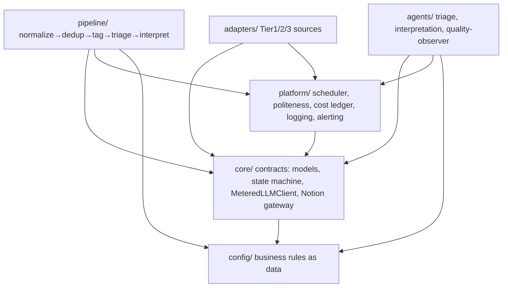

# Architecture Spine — Legal Intelligence Collection Layer

## Design Paradigm

**Pipes-and-filters pipeline over a shared blackboard.** Each pipeline stage is an idempotent *filter* that reads Items in one status and writes them in the next; **Notion is the blackboard** — the single shared state every stage reads from and writes to — and the Item's **`status` field is the pipe**: it is the only coordination mechanism between stages. Stages never call each other directly; they react to status. Scheduled *agents* (Triage, Interpretation, Quality Observer, built on the Claude Agent SDK) are filters triggered by a status becoming their input status.

Layer → namespace mapping (source tree in Structural Seed):

- **adapters/** — Source adapters (Tier 1/2/3), the only code that talks to the outside world.
- **pipeline/** — the filters: normalize, dedup, tag, triage, interpret.
- **agents/** — the Claude Agent SDK agents (triage, interpretation, quality observer).
- **core/** — the shared contracts: Item/SourceRecord models, the metered LLM client, the state machine, config loaders, the Notion gateway.
- **platform/** — cross-cutting: scheduler, scraping-politeness middleware, cost ledger, logging, alerting.
- **config/** — the business rules as data (see AD-8).

## Invariants & Rules

### AD-1 — Pipes-and-filters over a status blackboard
- **Binds:** all pipeline & agent code (FR-1..FR-21)
- **Prevents:** ad-hoc stage-to-stage coupling; hidden execution order; two stages "helping" each other and diverging.
- **Rule:** A stage's only inputs are Items in its input `status` (+ config); its only output is Items advanced to the next `status` (+ logs/ledger). Stages MUST NOT invoke another stage directly or assume ordering beyond the status contract.

### AD-2 — Notion is the single System of Record `[ADOPTED]`
- **Binds:** all state (FR-16, FR-17, FR-18)
- **Prevents:** dual-write divergence; ambiguity over where Item truth lives.
- **Rule:** Under Path B there is exactly one authoritative store of Item truth: the Notion "Legal Intelligence" database. Local files are staging/cache only and are never treated as authoritative after a successful Notion write. Any future external DB (Path A) is a projection, not a second source of truth. **All** Notion writes are upsert-by-key (AD-14), so a re-run is exactly-once per key; batch writes (≤100) are checkpointed per Item so a partial-batch failure re-runs only the unwritten items, never re-creating the written ones. Transient Class C full text is authoritative **in Notion** (child page/attachment) once written; `data/staging` is pre-write scratch only, and promote-to-A verifies full text is present in Notion before flipping the class (AD-5).

### AD-3 — One Source Adapter contract
- **Binds:** adapters/ (FR-1, FR-2, FR-3)
- **Prevents:** each Source inventing its own output shape; the normalizer needing per-source special cases.
- **Rule:** Every Source — Tier 1, 2, or 3 — implements the `SourceAdapter` interface and yields `SourceRecord`s carrying the unified mandatory field set (`source_id, source_name, title, type, authority, date_published, url, raw_metadata, collected_at, hash`). New sources add an adapter; they never modify downstream stages.

### AD-4 — Idempotent ingestion
- **Binds:** adapters/, pipeline/normalize, pipeline/dedup (FR-1, FR-4, FR-5)
- **Prevents:** duplicate Items when a source is re-polled; non-deterministic re-runs.
- **Rule:** Ingestion is keyed on `(source_id, source_name)` plus SHA-256 of normalized text. Re-seeing a record updates `last_seen_at`; it MUST NOT create a second Item. Every stage is safe to re-run on the same Item without side-effect drift.

### AD-5 — Content Class governs retention and schema
- **Binds:** dedup, triage, sync, retention (FR-9, FR-17)
- **Prevents:** storing full text for irrelevant items (cost, noise, PII surface); inconsistent field population.
- **Rule:** Class B persists metadata + URL only — no full text, no snippet beyond title, staging purged post-classification. Class C full text is written to Notion as transient and mirrored under a 7-day staging TTL (purge-or-promote); the Notion copy is authoritative (AD-2). Only Class A persists full text + interpretation permanently. No stage may write full text to a Class B Item. **Two distinct review statuses exist and must not be conflated:** `Awaiting Dedup Confirmation` (probable-duplicate 0.70–0.94; owner = dedup; actions = confirm-merge / reject-as-distinct) and `Class C – Awaiting Human Review` (ambiguous *relevance*; owner = triage; actions = Classify A / Classify B / Update Ontology). Each status has one owning writer and its own HITL action set.

### AD-6 — State-transition ownership is split and exclusive
- **Binds:** state machine, all stages, HITL (FR-13, FR-14, FR-15, FR-16)
- **Prevents:** the pipeline and a human racing the same `status`; a stage silently "approving" work.
- **Rule:** The pipeline performs **automatic** transitions only (ingested→triaged→interpreted→draft, plus `Superseded` on any Item including terminal ones when AD-15 fires). `Approve`, `Reject`, `Requires Action`, `Reclassify`, and dedup-confirmation are **human-only** transitions. No automated stage may perform a human-only transition; transitions not defined in the state machine are rejected. The full allowed-transition set lives in `core/state_machine.py` and is the single authority.

### AD-7 — All LLM calls are metered
- **Binds:** tagging, classifier, interpretation, agents, Environment B (FR-8, FR-10, FR-12, FR-21)
- **Prevents:** untracked spend; un-attributable cost; runaway loops going unnoticed.
- **Rule:** No component calls an LLM directly. Every call goes through the single `MeteredLLMClient`, which writes one Cost Ledger row (`timestamp, stage, model, input_tokens, output_tokens, usd_cost, item_id, success`) per call. Cowork usage tags `source: cowork_<agent>`.

### AD-8 — Business rules are config-as-data
- **Binds:** tagging, triage, interpretation (FR-6, FR-7, FR-12)
- **Prevents:** topics/rules/model-ids drifting between code and the legal team's intent; needing a code change to tune relevance.
- **Rule:** `ontology.yaml`, `relevance_rules.yaml`, `interpretation_config.yaml`, and `sources.yaml` are the single source of business logic. Topics, keywords, include/exclude rules, KAD codes, model IDs, escalation triggers, temperatures, cadences, and the merge **`authority_rank`** (which Source wins on merge, per Source in `sources.yaml`) MUST come from config, never be hard-coded. Code changes require re-deploy; rule changes do not.

### AD-9 — Interpretations validate before persist
- **Binds:** interpretation, sync (FR-10)
- **Prevents:** malformed/partial Class A records reaching reviewers.
- **Rule:** Interpretation output is parsed against the pydantic Interpretation schema before any Notion write. A validation failure fails that Item (alert + skip, leave in a ret/queue state) — it never produces a partial silent record. Every Interpretation persists as `Draft` with the not-legal-advice disclaimer.

### AD-10 — Scraping politeness is shared middleware
- **Binds:** adapters/ Tier 2 (FR-2)
- **Prevents:** each scraper re-implementing (and mis-implementing) rate limiting → publisher blocking and client exposure.
- **Rule:** All Tier-2 scrapers route outbound requests through one politeness middleware: ≤1 req/5s per domain with ±30% jitter, non-identifying rotating User-Agents, robots.txt respected, circuit breaker (3× 429/503 in 5 min → 30-min pause), backoff 2/4/8/16/32s, max 1 concurrent request/domain. A scraper MUST NOT issue raw outbound requests.

### AD-11 — Downstream shared-data contract (Environment B)
- **Binds:** triage, dedup, interpretation, sync (FR-22)
- **Prevents:** the Cowork agent layer breaking because a field it reads was never written.
- **Rule:** Every Item persists the downstream-consumed fields: `class_reasoning`, `confidence_score`, `additional_sources[]`, `external_commentary`, and precedent relations. A B→A re-fetch entry point (re-pull full text from `url` → enqueue Interpretation) MUST exist and be callable by the Reclassify path. Re-fetch is an **in-place full-text hydrate of the existing Item id** — it never re-enters ingestion keying (AD-14) and never mints a new Item, even if the re-extracted text hash differs.

### AD-12 — Failure isolation per source and per item
- **Binds:** orchestration, all stages (FR-19, FR-20)
- **Prevents:** one bad item or dead source taking down a whole batch or the pipeline.
- **Rule:** Every source poll and every item is processed inside a try-boundary. A failure isolates to that item/source: transient → retry with backoff (≤5); permanent → alert + skip + structured-log; the run continues. No unhandled exception may abort a batch.

### AD-13 — One owning consumer per status
- **Binds:** pipeline/, agents/ (FR-8, FR-10, FR-16)
- **Prevents:** an agent and a filter both reacting to the same input status → double LLM classification, double Cost Ledger rows, conflicting `ContentClass`/`class_reasoning` writes.
- **Rule:** Each `ItemStatus` has exactly **one** owning consumer module. Agents are the LLM *implementation invoked by* their owning stage (e.g. `pipeline/triage.py` owns `Awaiting Triage` and calls `agents/triage_agent.py`), never an independent status reactor. Two modules MUST NOT consume the same input status.

### AD-14 — Item creation is a key-serialized single-writer upsert
- **Binds:** pipeline/dedup, core/notion_gateway (FR-4, FR-5)
- **Prevents:** two concurrent polls of the same Legal Event both finding "no match" and both creating an Item (Notion has no unique constraint or transaction).
- **Rule:** Item creation goes through one `NotionGateway.upsert_item()` keyed on `(source_id, source_name)` + SHA-256 hash. Concurrent ingestion of the same key is serialized (in-process lock keyed on the dedup key at MVP; a durable lock if Path A is adopted). The gateway checks for an existing page by key **before** any `create`.

### AD-15 — `supersedes`/precedent relations are dedup-owned, Item↔Item
- **Binds:** pipeline/dedup, adapters/ (FR-1, FR-5, FR-22)
- **Prevents:** adapters (which have no Item id) and dedup both writing `supersedes` in incompatible key spaces; an orphaned relation.
- **Rule:** Precedent/`supersedes` relations are written **only** by dedup, as Item↔Item relations (Notion page ids). Adapters may emit a raw `supersedes_ref` inside `raw_metadata` (e.g. a CELEX string) but never write the relation. A superseding version creates a new Item that **inherits Topics + precedent links** from its target and drives the target through the `Superseded` transition (AD-6).

### AD-16 — Late merges past Interpretation re-interpret, never silently mutate
- **Binds:** pipeline/dedup, interpret (FR-5, FR-10)
- **Prevents:** a slow Tier-3 commercial duplicate merging `external_commentary` onto an already-Approved Item that interpretation never saw — dedup silently mutating a human-owned terminal record.
- **Rule:** When a merge adds interpretation-relevant fields (`external_commentary`, new `additional_sources`) to an Item already past Interpretation, dedup MUST enqueue a re-interpretation (or flag for review) rather than mutate an Approved Item in place.

### Dependency direction


*Rule: dependencies point inward toward `core`/`config`; `core` and `config` depend on nothing above them. Adapters, pipeline, and agents never import each other — they meet only at `core` contracts and the Notion status blackboard.*

## Consistency Conventions

| Concern | Convention |
| --- | --- |
| Entity naming | `SourceRecord` (raw capture), `Item` (deduped record), `SourceAdapter`, `Interpretation`, `ContentClass` (enum A/B/C), `ItemStatus` (enum) — verbatim from PRD Glossary; no synonyms in code. |
| Files / modules | snake_case modules; one adapter per file under `adapters/tier{1,2,3}/<source>.py`; one filter per file under `pipeline/`. |
| IDs | Item id = Notion page id (authoritative). Cross-source identity / upsert key = `(source_id, source_name)` + SHA-256 hash (AD-14). Never invent a second Item id scheme. |
| Dates & formats | ISO 8601 dates everywhere (`YYYY-MM-DD`); timestamps UTC ISO 8601. Text hash = SHA-256 of whitespace/punctuation-normalized full text. |
| Confidence fields (distinct owners) | `confidence_score` = the triage-classifier value **only** (FR-8). Dedup aggregate → `dedup_score`; interpretation self-assessment → `interpretation_confidence`. No field has two producers. |
| `class_reasoning` shape | Always the envelope `{decided_by: "rule"｜"llm", detail: <human-readable Greek>, rule_id?: str}` — both the deterministic-rule and LLM producers emit this shape so Env B's Explain agent gets one contract. |
| Errors | One `PipelineError` hierarchy: `TransientError` (retry) vs `PermanentError` (alert+skip). Adapters raise typed errors; stages never swallow silently. |
| Logging | Structured JSON only, fields `source, event, status, duration_ms, error, item_id`. No print/unstructured logs. |
| Config | All business rules in `config/*.yaml`, loaded once per run via `core/config`. Secrets (Notion token, Anthropic key) from environment/secret store, never in YAML or code. |
| LLM access | Only via `core.MeteredLLMClient`. Model IDs resolved from `interpretation_config.yaml` at call time. |
| Cost Ledger store | Authoritative in a Notion auxiliary "Cost Ledger" database (survives restart, feeds FR-21/SM-C3); writes buffer to a local append-only file and flush to Notion, so a crash loses at most the unflushed tail. |
| Notion access | Only via `core.NotionGateway` (enforces batch ≤100, 3 req/s, >2000 chars→child page, >100KB→attachment, class-aware payloads). No stage calls `notion-client` directly. |

## Stack

*SEED — verified current at authoring (2026-07-13); the code owns this once it exists.*

| Name | Version |
| --- | --- |
| Python | 3.12 |
| claude-agent-sdk | 0.2.x (agents) |
| anthropic (SDK) | current (single-shot metered calls) |
| notion-client | 3.1.0 |
| pydantic | 2.x (schema validation, AD-9) |
| httpx | current (async Tier-1 clients) |
| playwright | current (Tier-2 scraping) |
| pdfplumber | current (PDF text extraction; OCR choice deferred) |
| APScheduler | 3.x (in-process scheduler, MVP) |
| PyYAML | current (config-as-data) |
| pytest | current (Phase-0 fake-data validation) |

## Structural Seed

```text
mouhalis-legal/
  src/legal_intel/
    core/
      models.py           # SourceRecord, Item, Interpretation, ContentClass, ItemStatus (pydantic)
      state_machine.py     # allowed transitions; enforces AD-6
      llm_client.py        # MeteredLLMClient — the only LLM entry point (AD-7)
      notion_gateway.py    # the only Notion entry point; upsert-by-key (AD-2, AD-14)
      config.py            # loads config/*.yaml (AD-8)
    adapters/
      base.py             # SourceAdapter interface (AD-3)
      tier1/              # eurlex.py, diavgeia.py, vouli.py, edpb.py, efsa.py, gdprhub.py, datagovgr.py
      tier2/              # fek.py, ste.py, epant.py, efet.py, rasff.py, dpa.py
      tier3/              # inbox.py (shared-mailbox parser)
    pipeline/
      normalize.py        # AD-4
      dedup.py            # weighted signals, authority hierarchy (AD-4, AD-5)
      tag.py              # ontology-driven (AD-8)
      triage.py           # rules → LLM classifier (AD-8)
      interpret.py        # 7-step, schema-validated (AD-9)
    agents/
      triage_agent.py         # Claude Agent SDK, status-triggered
      interpretation_agent.py
      quality_observer.py     # weekly retro/drift
    platform/
      scheduler.py        # APScheduler cadences (AD-1 trigger)
      politeness.py       # shared scraping middleware (AD-10)
      cost_ledger.py      # AD-7 sink
      logging.py          # structured JSON
      alerting.py         # ops/legal channels
  config/
    sources.yaml          # per-source tier, endpoint, cadence
    ontology.yaml         # topics (client-validated; draft at MVP)
    relevance_rules.yaml  # include/exclude, KAD codes
    interpretation_config.yaml  # model ids, escalation, temperature
  data/
    staging/              # Class C transient full text (7-day TTL), fake-data fixtures
  tests/
    fixtures/             # fake Legal Events for Phase-0 end-to-end validation
  pyproject.toml
```

## Capability → Architecture Map

| Capability / FR | Lives in | Governed by |
| --- | --- | --- |
| FR-1 Tier-1 ingestion | adapters/tier1/ | AD-3, AD-4, AD-12 |
| FR-2 Tier-2 scraping | adapters/tier2/ + platform/politeness | AD-3, AD-10, AD-12 |
| FR-3 Tier-3 inbox | adapters/tier3/inbox | AD-3, AD-5 |
| FR-4 Normalization | pipeline/normalize | AD-4, conventions |
| FR-5 Deduplication | pipeline/dedup | AD-4, AD-5 |
| FR-6 Topic tagging | pipeline/tag | AD-8 |
| FR-7 Deterministic rules | pipeline/triage | AD-8 |
| FR-8 LLM classifier | pipeline/triage owns status, invokes agents/triage_agent | AD-7, AD-8, AD-13 |
| FR-9 Class-aware retention | dedup/triage/sync + data/staging | AD-5, AD-2 |
| FR-10/11/12 Interpretation | pipeline/interpret owns status, invokes agents/interpretation_agent | AD-7, AD-8, AD-9, AD-13 |
| FR-13/14/15 HITL workflows | Notion views + state_machine | AD-2, AD-6 |
| Dedup merge & precedent | pipeline/dedup | AD-4, AD-5, AD-14, AD-15, AD-16 |
| FR-16 State machine | core/state_machine | AD-6 |
| FR-17/18 Notion sync | core/notion_gateway | AD-2 |
| FR-19 Orchestration | platform/scheduler | AD-1, AD-12 |
| FR-20 Monitoring/alerting | platform/logging + alerting | AD-12, conventions |
| FR-21 Cost ledger | platform/cost_ledger + core/llm_client | AD-7 |
| FR-22 Environment B contract | core/models + notion_gateway | AD-11 |

## Deferred

- **Path A external DB (PostgreSQL + pgvector) and semantic retrieval** — deferred until >~50k Items or heavy analytics; keyword/topic retrieval at MVP. Migration = Notion→Postgres export retaining IDs.
- **Heavyweight infra (Prefect/Airflow, Grafana/Prometheus, Vault)** — MVP runs in-process APScheduler + structured logs + env secrets. Revisit at production scale.
- **OCR engine choice for scanned PDFs** — pdfplumber for text PDFs now; OCR (Tesseract vs cloud) decided when a scanned-PDF source proves it necessary (Δι@ύγεια).
- **RASFF integration mechanism** — scrape vs Apitalks (paid) — a source-level call, not an invariant; decided in the RASFF adapter story.
- **Exact Anthropic model IDs** — resolved from `interpretation_config.yaml` at build time against current availability (AD-8 keeps this out of code).
- **Notification transport** (Slack vs email) — an alerting adapter detail, not a spine invariant.
- **Environment B (Cowork agents)** — separate track; this spine only guarantees the AD-11 data contract they depend on.
